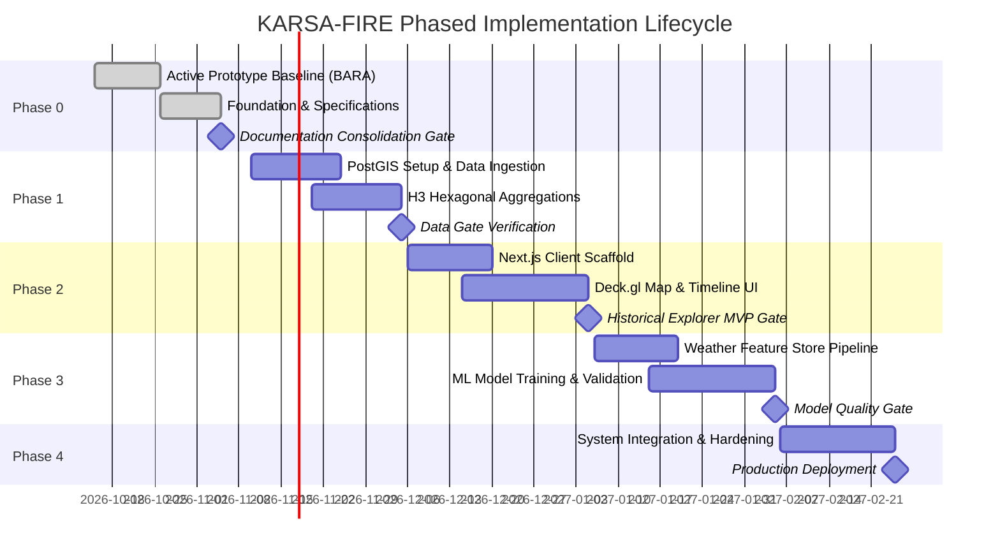

# Engineering Roadmap — KARSA-FIRE & BARA

> **Document Version:** 1.1.0  
> **Status:** Active Roadmap  
> **Current Phase:** Phase 0 (Baseline Consolidated & Governance Complete)

---

## Roadmap Overview & Phase Gates

---

## Phase 0: Technical Foundation & Baseline Consolidation (COMPLETED)

### Deliverables & Status
- [x] Functional baseline prototype in `project_pkmm-master/` (Flask, Sentinel-2 COG, XGBoost, Leaflet).
- [x] Test harness verified (`test_app.py`, `test_monitoring.py`, `test_frontend.cjs`).
- [x] Documentation consolidated: `docs/current/` (implemented) vs. `docs/future/` (planned).
- [x] Agent rules & skills organized under `.agents/`.
- [x] ADR-001 through ADR-008 recorded in `docs/DECISIONS.md`.
- [x] `docs/PROJECT_STATE.md` and `CHANGELOG.md` synchronized.

---

## Phase 1: Data Ingestion & Spatial Storage Pipeline (PLANNED)

### Objectives
- Set up local/containerized PostgreSQL 16 + PostGIS 3.4 database.
- Develop ingestion scripts for NASA FIRMS historical archives for the approved pilot study area.
- Implement H3 hexagonal index generation (Resolution 7 and 8) on ingested points.
- Create partitioned tables and automated spatial views.

### Exit Criteria
- Reproducible Docker Compose environment running PostgreSQL/PostGIS.
- Successfully ingested pilot hotspot dataset with verified coordinate fidelity.
- Pre-aggregated daily H3 table generated and queried in $<50\text{ ms}$.

---

## Phase 2: Historical Hotspot Web Application (PLANNED)

### Objectives
- Scaffold Next.js 14 (App Router, TypeScript) web application.
- Implement Deck.gl + MapLibre GL map container rendering base tiles and hotspot vector overlays.
- Build interactive timeline scrubber with daily FRP histogram.
- Build filter controls (Sensor, Confidence, Date Range, Administrative Region).
- Implement Cell Inspection Drawer showing historical events.

### Exit Criteria
- Seamless rendering of 50,000+ points at 60 FPS in WebGL2.
- Fully functional temporal scrubbing and filtering.

---

## Phase 3: Machine Learning & Predictive Risk Pipeline (PLANNED)

### Objectives
- Build feature extraction pipeline pulling ERA5-Land weather covariates and CHIRPS precipitation.
- Construct spatial-temporal dataset matrix indexed by `(h3_index, date)`.
- Benchmark Baseline Heuristic Models (Persistence & Simple FWI).
- Train LightGBM gradient boosted model using Blocked Spatio-Temporal Cross Validation.
- Evaluate PR-AUC, Brier calibration scores, and SHAP feature importances.
- Implement batch daily inference job writing forward risk scores to PostGIS.

### Exit Criteria
- Model outperforms baseline heuristics on out-of-time test sets.
- Brier calibration curve demonstrates reliable risk probabilities.
- Zero spatial-temporal data leakage verified.

---

## Phase 4: Operationalization, Security & Production Hardening (PLANNED)

### Objectives
- Integrate predictive risk layer into Next.js client interface with explainability drawer.
- Implement vector tile serving (`ST_AsMVT`) for scalable low-latency delivery.
- Conduct security hardening (rate limiting, bounding box sanity, secret management).
- Write automated end-to-end integration test suites and CI/CD pipelines.
