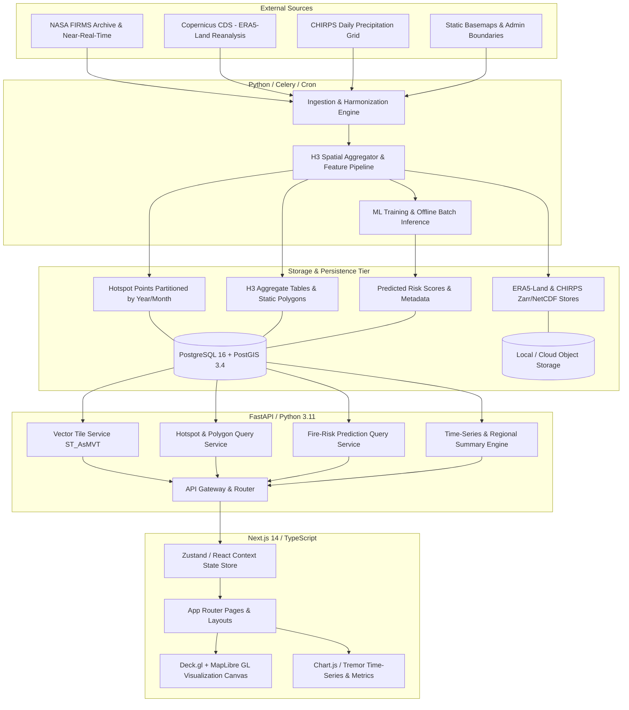

# System Architecture Specification — KARSA-FIRE Enterprise Target

> **Document Status:** PLANNED (Target Architecture — Phase 2+)  
> **Target Framework:** Decoupled 4-Tier Enterprise Topology  
> **Baseline Implementation:** Prototype in `project_pkmm-master/` (Flask, Leaflet, in-memory cache, COG streaming)

---

## 1. Architectural Philosophy & Design Principles

KARSA-FIRE is designed around five core architectural pillars for enterprise scale:
1. **Decoupled Data, Analytical, and Presentation Planes:** Heavy geospatial vector processing and model inference must never choke interactive map rendering or blocking web requests.
2. **Standardized Spatial Binning (Discrete Global Grid System):** Raw point observations from irregular satellite orbits are projected onto Uber H3 hexagonal cells to enable uniform time-series aggregation, multi-scale neighborhood analysis, and structured ML tabular features.
3. **Progressive Spatial Delivery:** Avoid sending massive raw point datasets over HTTP. Utilize viewport bounding-box queries, vector tiles (MVT/PBF), and clustered aggregations to maintain sub-second client performance.
4. **Reproducible ML & Strict Leakage Guardrails:** Feature engineering, historical lookbacks, and model inference operate under strict temporal guards (no future data leakage) and spatial blocking.
5. **Zero-Trust Security & Observability:** All bounding box, date-range, and filter queries are strictly validated and parameterized; health metrics and logs are exposed across all services.

---

## 2. Target Component Topology

---

## 3. Target Component Responsibilities

### 3.1 Client Application (`web`)
- **Technology:** Next.js 14+ (App Router, React, TypeScript), Tailwind CSS.
- **Responsibilities:**
  - Viewport-based interactive map controls (pan, zoom, pitch, bearing).
  - Multi-layer management (Hotspots, H3 Density Grid, Predicted Risk Heatmap).
  - Client-side layer blending, tooltip detection, and cell inspection drawer.
  - Interactive time-series scrubbers and regional vulnerability rankings.

### 3.2 Geospatial Map Engine (`web/components/map`)
- **Technology:** MapLibre GL + Deck.gl (`@deck.gl/react`, `@deck.gl/layers`, `@deck.gl/geo-layers`).
- **Responsibilities:**
  - GPU-accelerated WebGL2 rendering of $\ge 50,000$ points.
  - Dynamic H3 hexagonal layer rendering (`H3HexagonLayer`) with color interpolation mapped to FRP or Risk Score.
  - Vector basemaps via MapLibre GL.

### 3.3 Backend API Service (`backend`)
- **Technology:** FastAPI (Python 3.11+), Pydantic v2, asyncpg / SQLAlchemy 2.0 (async), GeoAlchemy2.
- **Responsibilities:**
  - Parameter validation and rate limiting.
  - Dynamic Mapbox Vector Tile generation (`ST_AsMVT`).
  - Analytical summary queries (daily counts, monthly trends, regional risk rankings).

### 3.4 Spatial Database Tier (`db`)
- **Technology:** PostgreSQL 16 + PostGIS 3.4 + `h3-pg` extension.
- **Responsibilities:**
  - Ingestion and spatial indexing (`GIST(geom)`, `BRIN(acq_date)`).
  - Declarative table partitioning by acquisition year/month.
  - Pre-aggregated H3 cells at daily and monthly intervals.

### 3.5 Data & ML Pipeline Service (`pipelines`)
- **Technology:** Python 3.11+, Pandas, GeoPandas, Xarray, Zarr, LightGBM / XGBoost.
- **Responsibilities:**
  - Ingestion and harmonization of NASA FIRMS active fire feeds.
  - Ingestion of gridded climate reanalysis (ERA5-Land: 2m temperature, relative humidity, wind, soil moisture) and CHIRPS precipitation.
  - Generation of spatial-temporal training matrices indexed by `(h3_index, date)`.
  - Batch daily inference into `fire_risk_predictions`.

---

## 4. Trade-off Analysis

| Decision Topic | Target Architecture | Current Prototype Reality | Migration Justification |
|---|---|---|---|
| **Frontend Framework** | Next.js 14 (App Router, TypeScript) | Vanilla JS + Leaflet 1.9.4 | Prototype is fast to run locally with zero build steps; Next.js allows SSR, rich component modularity, and typed state management. |
| **Map Rendering** | Deck.gl + MapLibre GL | Leaflet 1.9.4 (DOM Circles) | Leaflet handles up to ~3,000 points cleanly; Deck.gl provides WebGL2 buffers required for multi-year national scale (100k+ points). |
| **Spatial Indexing** | Uber H3 (DGGS Hexagons) | 3x3 Rectangular Grid + Ray-casting | Prototype samples 9 points per bbox; H3 provides equidistant continuous tessellation for regional machine learning. |
| **Backend Service** | FastAPI (Async REST / Tile) | Flask 3.x (Sync REST) | Flask serves prototype effortlessly; FastAPI provides async throughput and native OpenAPI 3.1 documentation. |
| **Vector Delivery** | PostGIS MVT binary tiles | GeoJSON REST arrays | GeoJSON is simple and readable; MVT reduces payload size by ~85% for dense point clouds. |

